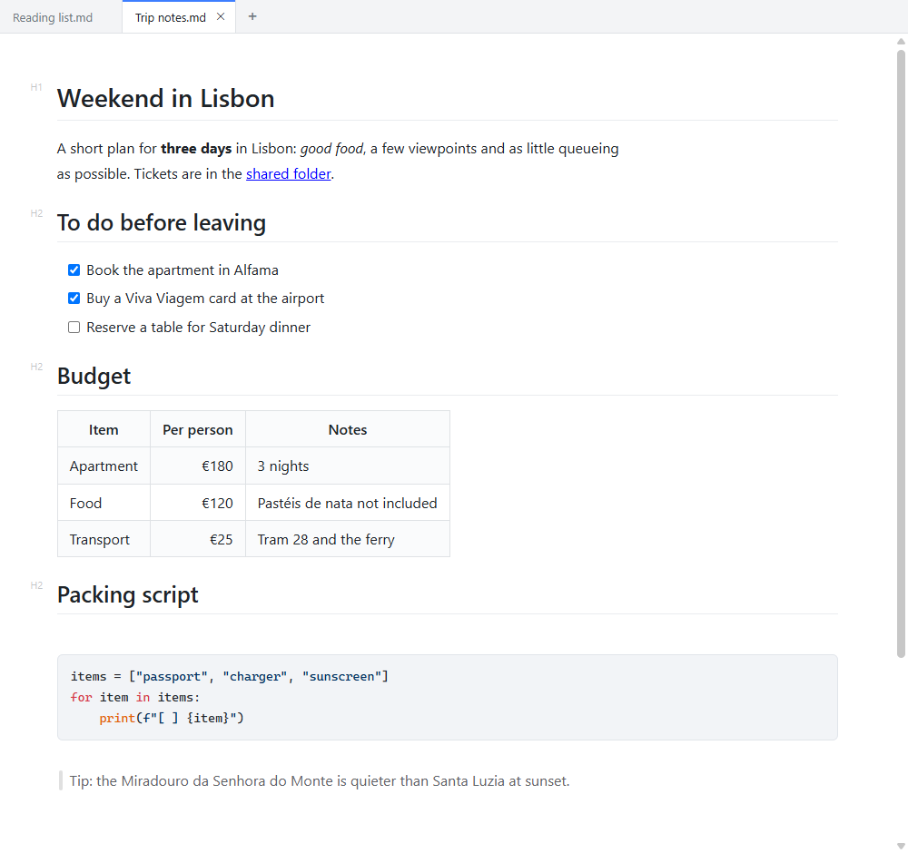

<p align="center">
  
</p>

<h1 align="center">Marky</h1>

<p align="center">
  A small, Typora-style markdown editor for Windows.<br>
  Markdown renders as you type, and your files stay exactly as you wrote them.
</p>

<p align="center">
  <a href="LICENSE"></a>
  
  
</p>

<picture>
  <source media="(prefers-color-scheme: dark)" srcset="docs/screenshot-dark.png">
  
</picture>

## About

Marky is a distraction-free markdown editor with inline rendering. There is no split preview:
headings, lists, tables and code render in place, and the syntax of the block under the cursor
(`**`, `#`, `[]()`) is revealed so you can edit it. It does tabs, open, save and a handful of
settings, and deliberately nothing more.

It's built with [Electron](https://www.electronjs.org/) and
[Vditor](https://github.com/Vanessa219/vditor) (in its "instant rendering" mode), and works
fully offline.

## Features

- **Inline rendering.** Write markdown and see it formatted right away, Typora style. `Ctrl+/`
  switches to the raw markdown source.
- **Exact saves.** Parts of a file you didn't edit are saved byte for byte, including line
  endings and a UTF-8 BOM. See [How saving works](#how-saving-works).
- **Tabs and hot exit.** Close the window at any time. Every tab, including unsaved edits and
  untitled documents, comes back the next time you open Marky.
- **Tables.** A toolbar and keyboard shortcuts for adding, moving, aligning and deleting rows
  and columns.
- **Code blocks** with syntax highlighting while you type and language suggestions.
- **Images.** Relative, absolute and web images, plus HTML `` tags (including Typora's
  resized images).
- **Find and replace** with match case, whole word and regular expressions.
- **Light and dark themes** that follow Windows, adjustable text width, fonts and line height.
- **Math and diagrams** via KaTeX, Mermaid and the other renderers Vditor includes.
- **Windows integration.** An installer, `.md` file association, and single-instance windows:
  opening a file while Marky is running adds a tab to the existing window.

## Installation

Marky is currently built from source. You need [Node.js](https://nodejs.org/) 22.12 or newer.

```sh
git clone https://github.com/MuhamedVrajolli/Marky.git
cd Marky
npm install
npm run dist:win
```

Then run `dist/Marky-Setup-<version>.exe`. The installer isn't code-signed, so Windows
SmartScreen warns the first time you run it (**More info** → **Run anyway**).

To open `.md` files with Marky by double-clicking them, right-click a `.md` file and choose
**Open with** → **Choose another app** → **Marky** → **Always**.

## Usage

### Keyboard shortcuts

| Action | Keys |
| --- | --- |
| New / Open / Save / Save As | `Ctrl+N` / `Ctrl+O` / `Ctrl+S` / `Ctrl+Shift+S` |
| Close tab | `Ctrl+W` (or middle-click the tab) |
| Next / previous tab | `Ctrl+Tab` / `Ctrl+Shift+Tab` (also `Ctrl+PgDn` / `Ctrl+PgUp`) |
| Toggle source mode (raw markdown) | `Ctrl+/` |
| Settings | `Ctrl+,` |
| Find / replace | `Ctrl+F` / `Ctrl+H` (or `Ctrl+R`) |
| Next / previous match | `Enter` / `Shift+Enter` in the find box, or `F3` / `Shift+F3` |
| Open a link | `Ctrl+click` (links to other `.md` files open in a new tab) |
| Zoom in / out / reset | `Ctrl+Shift+=` / `Ctrl+Shift+-` / `Ctrl+Shift+0` |
| Bold, italic, strike, link, inline code | `Ctrl+B`, `Ctrl+I`, `Ctrl+D`, `Ctrl+K`, `Ctrl+G` |
| Heading level / bigger / smaller | `Ctrl+Alt+1…6`, `Ctrl+=`, `Ctrl+-` |
| List, task list, quote, code block, table | `Ctrl+L`, `Ctrl+J`, `Ctrl+;`, `Ctrl+U`, `Ctrl+M` |
| Undo / redo | `Ctrl+Z` / `Ctrl+Y` or `Ctrl+Shift+Z` |
| Line break inside a paragraph or list item | `Shift+Enter` |

Markdown typed directly (`## `, `- `, `> `, ` ``` `, `**bold**`, …) is converted as you type.

### Code blocks

Type ` ``` `, optionally a language, then press `Enter`. Language suggestions appear as you type.
`Enter` keeps what you typed; to pick a suggestion, use the arrow keys and then `Enter`, or click
it. Inside a block, `Tab` indents by 4 spaces, and the code stays syntax-highlighted while you
edit it.

### Tables

Start a table by typing a header row such as `| Name | Qty |` and pressing `Enter`, or with
`Ctrl+M`. While the cursor is in a table, a toolbar above it inserts, deletes and moves rows and
columns, aligns the current column, or deletes the table.

| In a table | Keys |
| --- | --- |
| Next / previous cell | `Tab` / `Shift+Tab` |
| Cell below (adds a row at the end) | `Enter` |
| Line break inside a cell | `Shift+Enter` |
| Insert row below / above | `Ctrl+=` / `Ctrl+Shift+F` |
| Insert column right / left | `Ctrl+Shift+=` / `Ctrl+Shift+G` |
| Delete row / column | `Ctrl+-` / `Ctrl+Shift+-` |
| Leave the table | `↓` from the last row, or `↑` from the header |

### Find and replace

`Ctrl+F` searches the text you see, not markdown syntax such as `**` or link URLs. It has
options for match case, whole word and regular expressions, and `$1` works in the replacement.
`Ctrl+H` adds a replace box: `Enter` replaces the current match, and **All** replaces every match
as a single undo step. `Esc` closes the box and leaves the cursor on the match.

### Images

Marky shows images written in any of these forms:

| Form | Example |
| --- | --- |
| Relative to the document's folder | `` |
| Absolute path or `file://` URL | `` |
| Web image | `` |
| HTML tag, with `width`, `height` or `style="zoom:50%"` | `` |

Click an image to edit its source. Supported formats are PNG, JPEG, GIF, SVG, WebP, BMP, ICO and
AVIF. In markdown image syntax, paths with spaces must be written as `my%20image.png` or wrapped
in angle brackets: ``. In an untitled document, relative paths start working
once the document is saved.

## Settings

Open the settings with `Ctrl+,`:

- **Appearance:** theme (follow Windows, light or dark); side margins, either as a fixed text
  width in pixels or as a percentage of the window on each side (0% is full width); wrapping of
  long text in table cells; font, font size, line height and code font.
- **Editing:** auto-save (one second after you stop typing, for saved files) and spell check.
- **Startup:** keep tabs and unsaved changes when closing (see below), or else just reopen the
  previous session's files.

Settings and the session are stored in `%APPDATA%\Marky\settings.json` and `session.json`.

## Closing and reopening

By default Marky works like Sublime Text: closing the window never asks about unsaved changes.
Every tab comes back next time exactly as you left it, including unsaved edits and untitled
documents, which keep their unsaved dot until you save them. Unsaved changes are also stored
about a second after you stop typing, so they survive a crash or power cut.

They're kept in `%APPDATA%\Marky\backups`, one small file per tab with unsaved changes, deleted
when that tab is saved or closed. Closing a single tab with `Ctrl+W` still asks whether to save.
If a file changed on disk while Marky was closed and you had unsaved changes to it, Marky asks
which version to keep.

To get a save prompt on close instead, turn off **Keep tabs and unsaved changes when closing** in
Settings.

## How saving works

Vditor rebuilds the whole markdown document from the editor every time, and that round trip isn't
exact: it drops two-space line breaks, flattens indented code blocks, rewrites `***` as `---`, and
so on. Saving that output would quietly reformat, and sometimes change, your files.

Marky saves differently ([`fidelity.ts`](src/renderer/src/fidelity.ts)). It takes your edits as a
diff of the editor's content and applies only that diff to the original file text. Parts of the
file you didn't touch stay byte-for-byte identical, and line endings (CRLF or LF) and a UTF-8 BOM
are preserved. Before writing, Marky checks that the merged file renders exactly like what's on
screen; if it doesn't, it saves the editor's own output instead. Pressing `Ctrl+S` on a file you
haven't changed writes nothing.

Tables are the exception: if you change a table, the whole table is saved in the editor's tidy,
column-aligned format, while the rest of the file keeps its exact formatting.

## Development

```sh
npm install
npm run dev        # run with hot reload
npm run typecheck  # type-check the main and renderer code
npm run build      # build into out/
npm run dist:win   # build and package the Windows installer into dist/
npm run icon       # regenerate build/icon.ico and icon.png after editing the SVGs
```

Set `MARKY_USER_DATA=<folder>` to run with a separate settings and session folder, for example
next to an installed copy.

### Project structure

```text
src/
├── main/        App lifecycle, window, menu, file dialogs and I/O, settings and session storage
├── preload/     The small API exposed to the page as window.mark
├── renderer/    Tabs, the Vditor editor and its keyboard fixes, images, find and replace,
│                table toolbar, settings dialog and styles
└── shared/      Types and settings defaults shared by both sides
build/           App icon sources (SVG) and generated icons
scripts/         Asset copying and icon generation
```

The logo is `build/icon.svg`. `build/icon-small.svg` is a heavier-stroke version used for the
16–24 px sizes, so the icon stays sharp in the taskbar and Explorer.

Vditor is pinned to an exact version on purpose. Marky relies on some of its internals (the
markdown engine, icon loading, the code-block copy button), so check those after upgrading.

## Known limitations

- Editing a paragraph that references a footnote can move the footnote's definition to the end
  of the file. Vditor does this, and the file still renders the same.
- If an edit can't be mapped cleanly onto the original text, the edited region (or, rarely, the
  whole file) is saved in Vditor's own formatting.
- Switching to source mode and back (`Ctrl+/`) starts a fresh undo history.
- There is no outline, file tree, image pasting or export.
- Marky is built and tested on Windows only.

## Contributing

Bug reports and focused pull requests are welcome. Marky intentionally stays small, so please open
an issue to discuss a new feature before working on it. Before submitting a pull request, run
`npm run typecheck` and `npm run build`.

## License

Marky is released under the [MIT License](LICENSE).

## Acknowledgements

- [Vditor](https://github.com/Vanessa219/vditor) and its markdown engine
  [Lute](https://github.com/88250/lute), which do the heavy lifting of rendering and editing
- [Electron](https://www.electronjs.org/) and [electron-vite](https://electron-vite.org/)
- [highlight.js](https://highlightjs.org/), [KaTeX](https://katex.org/) and
  [diff-match-patch](https://github.com/google/diff-match-patch)
- [Typora](https://typora.io/), whose editing style inspired Marky. Marky is an independent project,
  not affiliated with Typora.
